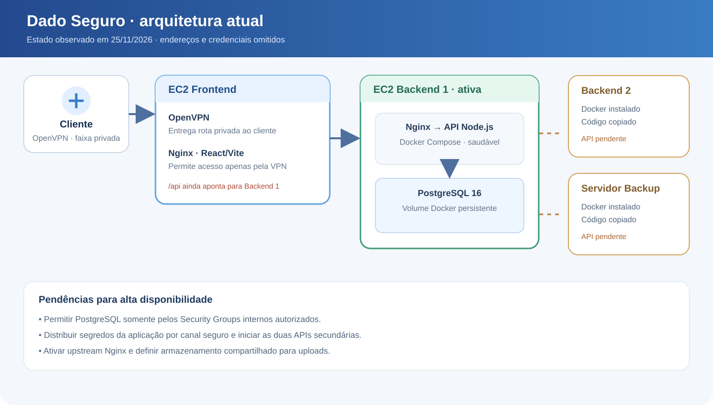
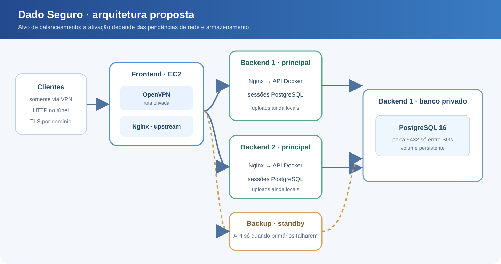

# 2. Arquitetura proposta

## Visão lógica

```text
Cliente OpenVPN (VPN_CIDR) --túnel--> Nginx Frontend (IP privado)
                                             | /api
                                             v
                                      Nginx Backend (proxy)
                                             | loopback:3000
                                             v
                                      API em Docker Compose ---> PostgreSQL 16
                                             |                      rede Docker privada
                                             +--> volume local de arquivos

Cliente fora da VPN --IP público--> Nginx Frontend (403)
```

## Diagramas





Na branch `1.1`, o OpenVPN entrega uma rota `/32` para o IP privado da Frontend. O Nginx libera a aplicação somente para clientes `VPN_CIDR`; acesso pelo IP público recebe `403`. O navegador usa HTTP dentro do túnel criptografado. O Nginx frontend encaminha `/api` ao Nginx da Backend 1, que envia ao processo API em `127.0.0.1:3000`. A API acessa `db:5432` na rede privada do Compose. PostgreSQL mantém dados em volume local Docker e não está publicado para as réplicas. A configuração ativa usa uma Backend 1 e não oferece alta disponibilidade ou backup externo.

## Fluxos esperados

1. Acesso público à aplicação apenas pelas portas web necessárias, idealmente HTTPS.
2. Administração por SSH restrito ao IP autorizado ou por acesso privado via VPN.
3. Serviços internos sem exposição direta à internet.
4. Quando houver aplicação e banco, permitir apenas os fluxos necessários entre camadas.

## Componentes

| Camada | Função planejada | Situação |
|---|---|---|
| AWS VPC/EC2 | Hospedar componentes selecionados | Quatro instâncias de laboratório; detalhes de rede não são publicados |
| Security Group | Filtrar tráfego | Modelo incluso |
| VPN | Acesso administrativo privado | Modelos OpenVPN inclusos |
| Nginx | Servir frontend e encaminhar `/api` | Configuração implantada e exemplos versionados |
| Frontend | Interface web | React/Vite compilado com API real |
| API | Regras e acesso a dados | Express/TypeScript em contêiner |
| Banco de dados | Persistência | PostgreSQL 16; tabelas criadas pelo script SQL versionado |
| Docker | Empacotamento e execução | API e banco ativos na Backend 1; Docker instalado nos nós secundários |

## Decisões em aberto

Completar acesso privado do banco às réplicas, storage compartilhado, domínio para TLS interno, backup/restauração e monitoramento.
