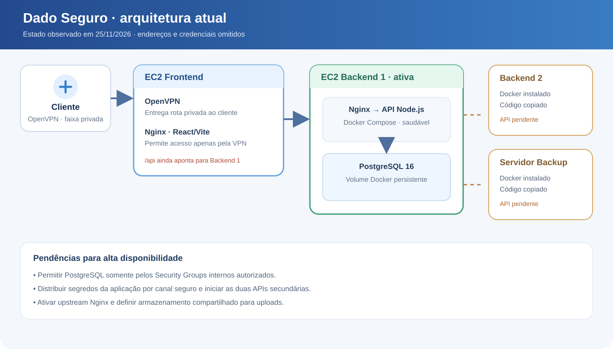

# 9. Estado da implantação

Última conferência: **25/11/2026**. Esta página registra estados verificados sem publicar IPs, IDs de instância, nomes de chaves ou credenciais.

## Serviços

| Componente | Estado confirmado |
|---|---|
| Frontend | Nginx serve a aplicação; OpenVPN ativo. Fora da VPN, o acesso web público responde `403`. Pela VPN, site e API respondem `200` no endereço privado. |
| Backend 1 | Docker Compose, API e PostgreSQL 16 ativos e saudáveis. PostgreSQL usa volume persistente e não publica `5432` para as outras instâncias. |
| Backend 2 | Docker Engine/Compose instalados; código da réplica copiado. Nginx ainda está no padrão e a API não foi iniciada. |
| Backup | Docker Engine/Compose instalados; código da réplica copiado. Nginx ainda está no padrão e a API não foi iniciada. |
| Acesso VPN no cliente | Cliente conecta, recebe endereço VPN e rota `/32` para o Frontend privado. A página e `/api/healthz` foram validadas pelo cliente. |
| HTTPS | Certificado de IP e listener TLS configurados no Frontend. A política bloqueia o acesso à aplicação pelo endereço público; o caminho de demonstração é HTTP para o IP privado dentro do túnel OpenVPN. Para TLS no endereço privado, é necessário domínio e resolução privada apropriados. |
| Git | A branch `1.1` parte da `main` do repositório renomeado `Dado_Seguro`. |

## Arquitetura atual

O frontend serve a interface e encaminha `/api` para uma única Backend 1. API e banco compartilham a rede Docker nessa instância. Os nós secundários estão preparados com Docker e arquivos, mas ainda não atendem tráfego.

## Pendências para balanceamento e failover

- Publicar PostgreSQL somente no IP privado da Backend 1 e restringir `TCP/5432` aos Security Groups da Backend 2 e Backup.
- Transferir os segredos de banco e sessão das réplicas por SSH, sem colocá-los no Git.
- Iniciar e validar as APIs secundárias; só então ativar o upstream Nginx com o backup em espera.
- Os arquivos enviados ficam em volumes locais. Download após failover exige armazenamento compartilhado ou replicação.
- Criar cópia de segurança externa e demonstrar uma restauração.

Use os placeholders `IP_PUBLICO_*` e `IP_PRIVADO_*` dos roteiros somente após consultar os endereços atuais no console AWS. Nunca inclua valores reais, chaves, senhas ou perfis VPN completos nesta documentação pública.
