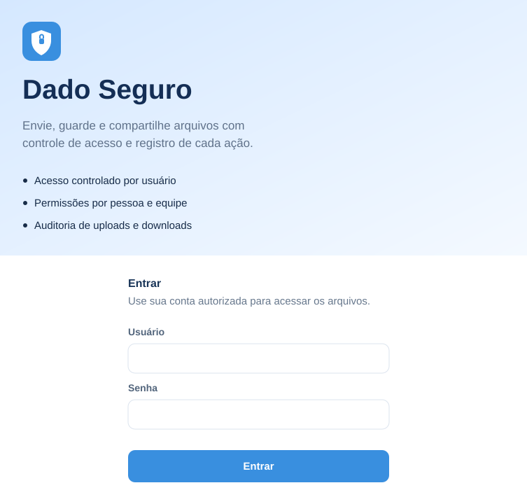

# Roteiro de provas do professor

Este roteiro organiza as verificações práticas da branch `1.1`. Faça as provas na ordem abaixo e use somente arquivos fictícios.

Os textos `IP_PUBLICO_*` e `IP_PRIVADO_*` são placeholders. Consulte os valores atuais no console AWS e substitua-os apenas nos comandos locais. Não publique endereços reais, IDs de instância, nomes de chaves ou credenciais.

## Situação atual

| Prova | Situação | Evidência verificada |
|---|---|---|
| Aplicação somente via VPN | Configurada e validada | Sem VPN, acesso público retorna `403`; pelo cliente conectado, página privada e `/api/healthz` retornam `200`. |
| Persistência PostgreSQL | Configurada e exercitada | API e banco foram parados e iniciados sem remover volumes; a contagem de usuários permaneceu igual e a API voltou saudável. |
| Dockerfile e Compose | Stack ativa na Backend 1; Compose base agora versionado | A instância já tem Dockerfile/Compose ativos. `compose.yaml` entrou no Git nesta etapa; sincronize o arquivo antes de recriar o banco ou instalar replicas. |
| Tabelas via script SQL montado | Configurado e exercitado | `001_initial_schema.sql` é montado como somente leitura no container PostgreSQL; as quatro tabelas foram listadas. |
| Nginx com dois backends e servidor backup | **Preparação implantada; ativação pendente** | Backend 2 (`IP_PRIVADO_BACKEND2`) e Backup (`IP_PRIVADO_BACKUP`) têm Docker/Compose ativos e arquivos da réplica em `/opt/dado-seguro`; Nginx ainda é padrão e não há API rodando. PostgreSQL não está publicado na rede privada. Não execute o teste de parada antes de ativar as réplicas e aplicar os Security Groups restritos. |

## Sequência recomendada

1. Conecte o OpenVPN no computador do aluno e confirme a rota para `IP_PRIVADO_FRONTEND`.
2. Mostre ao professor que `https://IP_PUBLICO_FRONTEND` retorna `403` sem VPN.
3. Com VPN conectada, abra `http://IP_PRIVADO_FRONTEND` e confirme `/api/healthz`.
4. Entre com a conta autorizada, envie um arquivo fictício e verifique a linha em PostgreSQL.
5. Mostre o Dockerfile, o Compose e o volume persistente.
6. Pare e inicie os containers **sem remover os volumes**; confirme que os dados continuam presentes.
7. Demonstre Nginx/load balancing/failover somente depois de concluir os pré-requisitos da seção [Nginx e failover](05-nginx-load-balancer-backup.md).

## Acesso e cautelas

- Site pela VPN: `http://IP_PRIVADO_FRONTEND`
- IP público, que deve ser bloqueado fora da VPN: `https://IP_PUBLICO_FRONTEND`
- Faixa dos clientes VPN: `VPN_CIDR`
- Endpoint OpenVPN atual: `IP_PUBLICO_FRONTEND:1194/UDP`
- O acesso ao IP privado usa HTTP encapsulado no túnel OpenVPN. O Compose da branch `1.1` deixa o cookie sem a flag `Secure` para permitir a sessão nesse HTTP interno; não exponha a aplicação fora da política VPN.
- Nunca execute `docker compose down -v` durante a prova: `-v` remove os volumes que mantêm banco e arquivos.
- Não mostre nem copie os arquivos `.pem`, segredos Compose, senha do administrador ou perfil OpenVPN.

## Páginas por prova

- [01 — Acesso via VPN](01-vpn-acesso.md)
- [02 — Persistência dos dados](02-persistencia.md)
- [03 — Dockerfile e Compose](03-docker-compose.md)
- [04 — Tabelas PostgreSQL](04-postgresql-schema.md)
- [05 — Nginx, balanceamento e servidor backup](05-nginx-load-balancer-backup.md)
